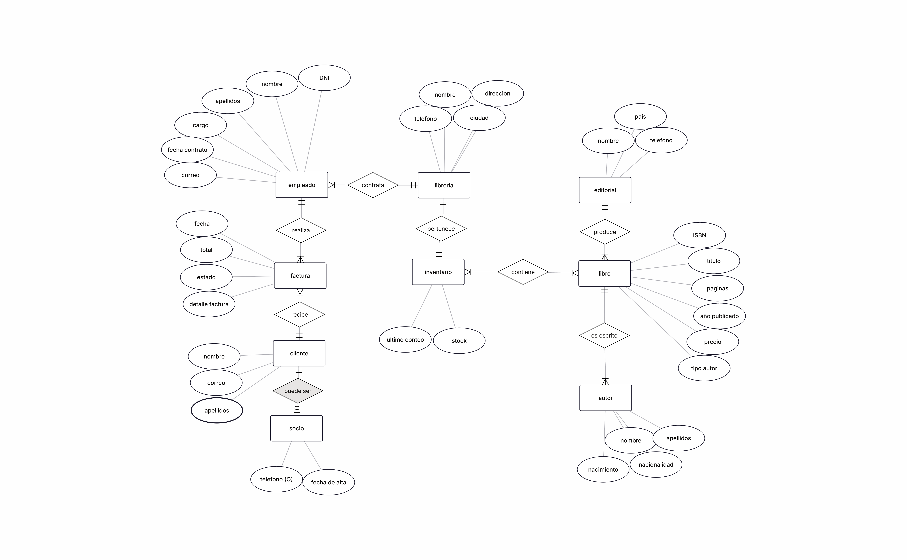

# Base de datos de Páginas de Villa Serena

## 1. Resumen del caso
Páginas de Villa Serena es una librería que abrió hace veinte años como una pequeña tienda de barrio y que hoy tiene tres tiendas: Centro, Ribera y Universidad. Su dueña, Elena Ruiz, nos ha encargado una base de datos para llevar el negocio de forma ordenada.

Ahora mismo cada tienda lleva su propia hoja de cálculo y la información no coincide con la realidad. Por ejemplo, un cliente quiso Cien años de soledad, la hoja decía que había tres copias y en la estantería no había ninguna, porque estaban todas en otra tienda. Además, cuando Elena sube el precio de un libro, los pedidos antiguos pasan a mostrar el precio nuevo y las facturas dejan de cuadrar.

---
### 2.1 Entidades y atributos

| Entidad | Atributos | Dónde sale |
| :---- | :---- | :---- |
| Tienda | nombre, dirección, teléfono, ciudad | §1 |
| Editorial | nombre, país, teléfono | §2 |
| Libro | ISBN, título, año de publicación, páginas, precio de catálogo | §2 |
| Autor | nombre, nacionalidad, año de nacimiento | §2 |
| Autoría (autor–libro) | rol (principal o colaborador) | §2 |
| Inventario (tienda–libro) | copias, fecha del último conteo | §3 |
| Empleado | DNI, nombre, apellidos, cargo, fecha de contratación, correo | §4 |
| Cliente | nombre, correo, teléfono (opcional), fecha de alta (solo socios) | §5 |
| Pedido | número, fecha, forma de pago, estado | §6 |
| Línea de pedido (pedido–libro) | cantidad, precio cobrado | §6 |
---
### 2.2 Relaciones

| Relación | Cardinalidad | Razonamiento |
| :---- | :---- | :---- |
| Editorial – Libro | 1:N | Una editorial publica muchos libros; cada libro, una sola editorial (§2). |
| Autor – Libro | N:M | Un libro puede tener varios autores y un autor varios libros. Se resuelve con Autoría (§2). |
| Tienda – Libro | N:M | Un libro puede estar en varias tiendas y una tienda tiene muchos libros. Se resuelve con Inventario (§3). |
| Tienda – Empleado | 1:N | Una tienda tiene varios empleados; cada empleado trabaja en una sola (§4). |
| Tienda – Pedido | 1:N | Un pedido se hace en una sola tienda; una tienda tiene muchos pedidos (§6). |
| Empleado – Pedido | 1:N | Un empleado atiende muchos pedidos; cada pedido lo atiende uno (§6). |
| Cliente – Pedido | 1:N | Un cliente hace muchos pedidos; cada pedido es de un cliente (§6). |
| Pedido – Libro | N:M | Un pedido lleva varios libros y un libro está en muchos pedidos. Se resuelve con Línea de pedido (§6). |
---
### 2.3 Datos descartados

| Dato | Motivo |
| :---- | :---- |
| Total del pedido y subtotales del ticket | Se calculan: cantidad × precio cobrado. |
| Nombre de la tienda, del empleado y del cliente en el ticket | Ya están en sus propias tablas. |
| «Stock» dentro del libro | Depende de la tienda, así que se guarda en Inventario. |
| «Cortázar / Borges» en una sola celda | Se guarda un autor por fila, unido al libro con Autoría. |
| Editorial repetida en cada fila de la hoja | Se guarda una vez y los libros apuntan a ella. |
| Historial de empleados | Elena solo quiere que figure en la tienda nueva (§4). |
---
## 3. Reglas de negocio

1. Cada libro se identifica por su ISBN, que tiene 13 cifras y no se repite. (§2)
2. Una editorial publica muchos libros; cada libro lo publica una sola editorial. (§2)
3. Un libro puede tener uno o varios autores y un autor puede tener varios libros; en cada libro, el autor consta como principal o como colaborador. (§2)
4. Para cada libro y cada tienda se guarda cuántas copias hay y cuándo se contaron por última vez, en una sola fila por cada pareja libro–tienda. (§3)
5. Si un libro no está en una tienda, no tiene fila en el inventario de esa tienda; si está pero no quedan copias, tiene una fila con 0 copias (agotado). (§3 y hoja de la §8)
6. El número de copias de un libro en una tienda no puede ser negativo. (§3)
7. Una tienda tiene varios empleados; cada empleado trabaja en una sola tienda y, si cambia, solo figura en la nueva. (§4)
8. El cargo de un empleado solo puede ser librero, cajero o encargado, y su DNI no se repite. (§4)
9. Todo cliente, sea socio o no, se registra con su nombre y su correo; el correo no se puede repetir y el teléfono es opcional. (§5)
10. Un cliente es socio si tiene fecha de alta; el que no es socio no la tiene. (§5)
11. Cada pedido se hace en una sola tienda, lo atiende un solo empleado y lo compra un solo cliente. (§6)
12. Todo pedido tiene fecha, una forma de pago (efectivo, tarjeta o bizum) y un estado (preparado, entregado o cancelado). (§6)
13. Un pedido incluye uno o varios libros distintos y, de cada uno, la cantidad pedida, que es como mínimo 1. (§6)
14. Cada línea de pedido guarda el precio que se cobró realmente por el libro; ese precio no cambia aunque después cambie el precio de catálogo y no puede ser negativo. (§6)
15. El total de un pedido no se guarda: se calcula sumando cantidad × precio cobrado de todas sus líneas. (§6)

## 4. Diagrama entidad-relación



## 5. Modelo lógico
El modelo tiene 10 tablas. En autoria, inventario y linea_pedido la clave primaria está formada por dos columnas.

*Editorial*

| Columna | Clave | Referencia |
| :---- | :---- | :---- |
| ideditorial | PK |  |
| nombre |  |  |
| pais |  |  |
| telefono |  |  |


*libro*

| Columna | Clave | Referencia |
| :---- | :---- | :---- |
| idlibro | PK |  |
| ISBN |  |  |
| ideditorial | FK | ideditorial |
| titulo |  |  |
| publicado |  |  |
| paginas |  |  |
| precio |  |  |
| tipo_autor |  |  |

*autor*

| Columna | Clave | Referencia |
| :---- | :---- | :---- |
| id | PK |  |
| nombre |  |  |
| apellidos |  |  |
| nacionalidad |  |  |
| nacimiento |  |  |

*libreria*

| Columna | Clave | Referencia |
| :---- | :---- | :---- |
| idlibreria | PK |  |
| nombre |  |  |
| direccion |  |  |
| telefono |  |  |

*inventario*

| Columna | Clave | Referencia |
| :---- | :---- | :---- |
| idinventario | PK |  |
| idlibro | FK | idlibro |
| idlibreria | FK | idlibreria |
| stock |  |  |
| ultimo_conteo |  |  |

*empleado*

| Columna | Clave | Referencia |
| :---- | :---- | :---- |
| idempleado | PK |  |
| idlibreria | FK | idlibreria |
| DNI |  |  |
| nombre |  |  |
| apellidos |  |  |
| cargo |  |  |
| fecha_contrato |  |  |
| correo |  |  |

*cliente*

| Columna | Clave | Referencia |
| :---- | :---- | :---- |
| idcliente | PK |  |
| nombre |  |  |
| apellidos |  |  |
| correo |  |  |

| Columna | Clave | Referencia |
| :---- | :---- | :---- |
| idsocio | PK |  |
| idcliente | |  |
| telefono |  |  |
| fecha_alta |  |  |

*factura*

| Columna | Clave | Referencia |
| :---- | :---- | :---- |
| idfactura | PK |  |
| idlibreria | FK | idlibreria |
| idempleado | FK | idempleado |
| idcliente | FK | idcliente |
| fecha |  |  |
| tipo_pago |  |  |
| total |  |  |
| estado |  |  |
| detalles_factura |  |  |
---
## 6. Script SQL (schema.sql)
El script completo está en [`schema.sql`](schema.sql). Borra y vuelve a crear la base de datos `libreria` con sus 9 tablas, en un orden que respeta las claves foráneas: primero las que no dependen de otras (`editorial`, `libreria` y `cliente`) y después `libro`, `autor`, `empleado`, `inventario`, `socio` y `factura`. Se usan claves primarias con `AUTO_INCREMENT`, claves foráneas, `UNIQUE` para el ISBN, `NOT NULL` y `ENUM` para los valores fijos (cargo, tipo de pago, estado y tipo de autor). Aquí se muestran solo las sentencias de creación; al final de `schema.sql` están los `INSERT` de los datos de prueba (apartado 9).

```sql
-- Base de datos de la libreria Paginas de Villa Serena
-- Se puede ejecutar varias veces: borra y recrea la base de datos.
DROP DATABASE IF EXISTS libreria;
CREATE DATABASE libreria DEFAULT CHARACTER SET utf8mb4;
USE libreria;

-- 1. Tablas que no dependen de otras
CREATE TABLE editorial (
  ideditorial  int          NOT NULL AUTO_INCREMENT,
  nombre       varchar(45)  NOT NULL,
  pais         varchar(45)  NOT NULL,
  teléfono     varchar(15)  NOT NULL,
  PRIMARY KEY (ideditorial)
);

CREATE TABLE libreria (
  idlibreria  int          NOT NULL AUTO_INCREMENT,
  nombre      varchar(45)  NOT NULL,
  direccion   varchar(45)  NOT NULL,
  telefono    varchar(15)  NOT NULL,
  ciudad      varchar(45)  NOT NULL,
  PRIMARY KEY (idlibreria)
);

CREATE TABLE cliente (
  idcliente  int           NOT NULL AUTO_INCREMENT,
  nombre     varchar(45)   NOT NULL,
  apellidos  varchar(50)   NOT NULL,
  correo     varchar(100)  NOT NULL,
  PRIMARY KEY (idcliente)
);

-- 2. Tablas que dependen de las anteriores (el orden respeta las claves foraneas)
CREATE TABLE libro (
  idlibro      int           NOT NULL AUTO_INCREMENT,
  ISBN         varchar(13)   NOT NULL,
  ideditorial  int           NOT NULL,
  titulo       varchar(45)   NOT NULL,
  publicado    year          NOT NULL,
  paginas      int           NOT NULL,
  precio       decimal(5,2)  NOT NULL,
  tipo_autor   enum('Principal','colaborador')  NOT NULL,
  PRIMARY KEY (idlibro),
  UNIQUE KEY ISBN_UNIQUE (ISBN),
  KEY fk_libro_ideditorial_idx (ideditorial),
  CONSTRAINT fk_libro_ideditorial FOREIGN KEY (ideditorial) REFERENCES editorial (ideditorial)
);

CREATE TABLE autor (
  idautor       int          NOT NULL AUTO_INCREMENT,
  idlibro       int          NOT NULL,
  nombre        varchar(45)  NOT NULL,
  apellidos     varchar(45)  NOT NULL,
  nacionalidad  varchar(45)  NOT NULL,
  nacimiento    date         NOT NULL,
  PRIMARY KEY (idautor),
  KEY fk_autor_idlibro_idx (idlibro),
  CONSTRAINT fk_autor_idlibro FOREIGN KEY (idlibro) REFERENCES libro (idlibro)
);

CREATE TABLE empleado (
  idempleado      int           NOT NULL AUTO_INCREMENT,
  idlibreria      int           NOT NULL,
  DNI             varchar(9)    NOT NULL,
  nombre          varchar(45)   NOT NULL,
  apellidos       varchar(45)   NOT NULL,
  cargo           enum('librero','cajero','encargado')  NOT NULL,
  fecha_contrato  date          NOT NULL,
  correo          varchar(100)  NOT NULL,
  PRIMARY KEY (idempleado),
  KEY fk_empleado_idlibreria_idx (idlibreria),
  CONSTRAINT fk_empleado_idlibreria FOREIGN KEY (idlibreria) REFERENCES libreria (idlibreria)
);

CREATE TABLE inventario (
  idinventario   int   NOT NULL AUTO_INCREMENT,
  idlibro        int   NOT NULL,
  idlibreria     int   NOT NULL,
  stock          int   NOT NULL,
  ultimo_conteo  date  NOT NULL,
  PRIMARY KEY (idinventario),
  KEY fk_inventario_idlibreria_idx (idlibreria),
  KEY fk_inventario_idlibro_idx (idlibro),
  CONSTRAINT fk_inventario_idlibreria FOREIGN KEY (idlibreria) REFERENCES libreria (idlibreria),
  CONSTRAINT fk_inventario_idlibro FOREIGN KEY (idlibro) REFERENCES libro (idlibro)
);

CREATE TABLE socio (
  idsocio     int          NOT NULL AUTO_INCREMENT,
  idcliente   int          NOT NULL,
  telefono    varchar(15)  DEFAULT NULL,
  fecha_alta  date         NOT NULL,
  PRIMARY KEY (idsocio),
  KEY fk_socio_idcliente_idx (idcliente),
  CONSTRAINT fk_socio_idcliente FOREIGN KEY (idcliente) REFERENCES cliente (idcliente)
);

CREATE TABLE factura (
  idfactura         int            NOT NULL AUTO_INCREMENT,
  idlibreria        int            NOT NULL,
  idempleado        int            NOT NULL,
  idcliente         int            NOT NULL,
  fecha             date           NOT NULL,
  tipo_pago         enum('efectivo','tarjeta','bizum')  NOT NULL,
  total             decimal(10,2)  NOT NULL,
  estado            enum('preparado','entregado','cancelado')  NOT NULL,
  detalles_factura  varchar(5000)  NOT NULL,
  PRIMARY KEY (idfactura),
  KEY fk_factura_idlibreria_idx (idlibreria),
  KEY fk_factura_idempleado_idx (idempleado),
  KEY fk_factura_idcliente_idx (idcliente),
  CONSTRAINT fk_factura_idcliente FOREIGN KEY (idcliente) REFERENCES cliente (idcliente),
  CONSTRAINT fk_factura_idempleado FOREIGN KEY (idempleado) REFERENCES empleado (idempleado),
  CONSTRAINT fk_factura_idlibreria FOREIGN KEY (idlibreria) REFERENCES libreria (idlibreria)
);
```
---
## 7. Diccionario de datos

Elementos o columnas con las que cuentan las tablas(a excepción del id que hace de clave primaria de cada tabla):

### Editorial
| Columna | Tipo | Obligatorio | Descripción |
|---|---|:---:|---|
| `nombre` | `VARCHAR(45)` | Sí | Nombre de la editorial |
| `pais` | `VARCHAR(45)` | Sí | Pais de la sucursal de la editorial |
| `teléfono` | `VARCHAR(15)` | Sí | Teléfono de la editorial |
---
### Libro
| Columna | Tipo | Obligatorio | Descripción |
|---|---|:---:|---|
| `ISBN` | `VARCHAR(13)` | Sí | Código de identificación único de cada libro. Formato de 13 carácteres debido a que es un estándar |
| `ideditorial` | `INT` | Sí | Identificador correspondiente a la editorial que distribuye el libro |
| `titulo` | `VARCHAR(45)` | Sí | Título del libro |
| `publicado` | `YEAR` | Sí | Fecha de lanzamiento de la edición del libro |
| `páginas` | `INT` | Sí | Cantidad de páginas que tiene el libro |
| `precio` | `DECIMAL(5,2)` | Sí | Precio del libro, esperando que no haya ningún libro que haya que insertar que cuesta más de 1000€ |
| `tipo_autor` | `ENUM('principal','colaborador')` | Sí | Típo de autor que escribe según si escribe todo el libro o se encarga de alguna parte solamente |
---
### Autor
| Columna | Tipo | Obligatorio | Descripción |
|---|---|:---:|---|
| `idlibro` | `INT` | Sí | Identificador del libro escrito por el autor |
| `nombre` | `VARCHAR(45)` | Sí | Nombre del autor |
| `apellidos` | `VARCHAR(45)` | Sí | Apellidos del autor |
| `nacionalidad` | `VARCHAR(45)` | Si | Nacionalidad del autor |
| `nacimiento` | `DATE` | Si | Fecha de nacimiento del autor |
---
### Librería
| Columna | Tipo | Obligatorio | Descripción |
|---|---|:---:|---|
| `nombre` | `VARCHAR(45)` | Sí | Nombre de la librería |
| `dirección` | `VARCHAR(45)` | Sí | Direccíon  de la librería para poder localizarla |
| `teléfono` | `VARCHAR(15)` | Sí | Teléfono de la librería |
| `ciudad` | `VARCHAR(45)` | Si | Ciudad donde se ubica la librería |
---
### Inventario
| Columna | Tipo | Obligatorio | Descripción |
|---|---|:---:|---|
| `idlibro` | `INT` | Sí | Identificador del libro que queremos llevar el conteo |
| `idlibreria` | `INT` | Sí | Identificador de la librería al que pertenece el inventario |
| `stock` | `INT` | Sí | Cantidad de copias de un libro que hay en el inventario |
| `ultimo_conteo` | `DATE` | Si | Última vez que se revisó el inventario |
---
### Empleado
| Columna | Tipo | Obligatorio | Descripción |
|---|---|:---:|---|
| `idlibreria` | `INT` | Sí | Identificador de la librería en la que trabaja el empleado |
| `DNI` | `VARCHAR(9)` | Sí | Código de identificación del documento nacional de identidad |
| `nombre` | `VARCHAR(45)` | Sí | Nombre del empleado |
| `apellidos` | `VARCHAR(45)` | Sí | apellidos del empleado |
| `cargo` | `ENUM('librero','cajero','encargado)` | Sí | Puesto de trabajo entre los 3 indicados que ocupa el empleado |
| `fecha_contrato` | `DATE` | Sí | Fecha en la que se realizó el contrato del empleado |
| `correo` | `VARCHAR(50)` | Sí | Correo del empleado al que se le envían las notificaciones del trabajo |
---
### Cliente
| Columna | Tipo | Obligatorio | Descripción |
|---|---|:---:|---|
| `nombre` | `VARCHAR(45)` | Sí | Nombre del cliente atendido |
| `apellidos` | `VARCHAR(45)` | Sí | apellidos del cliente atendido |
| `correo` | `VARCHAR(100)` | Sí | Correo del cliente al que se le envían  |
---
### Socio
| Columna | Tipo | Obligatorio | Descripción |
|---|---|:---:|---|
| `idcliente` | `VARCHAR(45)` | Sí | Identificador correspondiente a un cliente |
| `teléfono` | `VARCHAR(15)` | No | Número de teléfono no obligatorio de los socios |
| `fecha_alta` | `DATE` | Sí | Fecha en la que el cliente se hizo socio |
---
### Factura
| Columna | Tipo | Obligatorio | Descripción |
|---|---|:---:|---|
| `idlibreria` | `INT` | Sí | Identificador correspondiente a la libreria donde se realiza la factura |
| `idempleado` | `INT` | Sí | Identificador correspondiente al empleado que realiza la factura |
| `idcliente` | `INT` | Sí | Identificador correspondiente al cliente que recibe la factura |
| `fecha` | `DATE` | Sí | Fecha en la que se realizó la factura |
| `tipo_pago` | `ENUM('efectivo','tarjeta','bizum)` | Sí | Método de pago que uso el cliente |
| `total` | `DECIMAL(10,2)` | Sí | Coste de todos los artículos más el IVA |
| `estado` | `ENUM('preparado','entregado','cancelado)` | Sí | Estado en el que se encuentra lo comprado por el cliente |
| `detalles_factura` | VARCHAR(5000) | Si | Los diferentes artículos comprados por el cliente |
---
## 8. Decisiones de diseño

Decisiones tomadas sobre diferentes elementos de la base de datos

> **Decisión:** Se decidio que era el inventario era quien tenía el id del libro.
> **Por qué:** La idea del inventario es que se sepa cuantas copias hay de cada libro por tienda por lo que lo que importa del inventario no es el id del inventario sino que importa el id del libro + el id de la tienda.
> **Decisión descartada:** Guardar el id del inventario en el libro
---
> **Decisión:** Los detalles de la factura que son los diferentes artículos comprados se guardan en la propia factura.
> **Por qué:** Simplifica la base de datos y junta todos los elementos de la factura en vez de tenerlos por separado.
> **Decisión descartada:** Realizar una 9ª tabla que fuese los detalles de la factura.
---
> **Decisión:** Los números de teléfono de las diferentes tablas cuentan con más carácteres de los necesarios.
> **Por qué:** La norma en España es que un número sea de 9 carácteres o de 12 si contamos el prefijo pero si contamos con números de otros paises, ni los prefijos ni la longitud de los números es la misma.
> **Decisión descartada:** números de teléfono en las tablas de 9 o 12 carácteres.
---
> **Decisión:** Número del ISBN guardado con una longitud de 13 carácteres.
> **Por qué:** Impide que se inserten espacios o guiones para separar puesto que no entraría el ISBN entero sino.
> **Decisión descartada:** ISBN de 17 a 20 carácteres.
## 9. Datos de prueba

Ejemplo de orden a la hora de meter los datos:

### Editorial

Editorial no depende de nada

```sql
insert editorial(nombre,pais,teléfono)
values('editorial pepe','España','976583746'),
('éditions Baguette','Francia','976583746'),
('editora El Bicho','Portugal','215837462');
```
---
### Libro

Libro depende de editorial

```sql
insert libro(isbn,ideditorial,titulo,publicado,paginas,precio,tipo_autor)
values('9788416345276',1,'Rayuela',2014,200,10.34,'principal'),
('9783161484100',3,'Ficciones',2020,200,11.99,'principal'),
('9780143127741',1,'Cuentos de Eva Luna',2000,200,8,'principal'),
('9788437604947',2,'Antología del cuento',2011,200,13.82,'Colaborador'),
('9782070360024',1,'La casa de los espíritus',2007,200,15.80,'principal');
```
---
### Autor

Autor depende de libro

```sql
insert autor(idlibro,nombre,apellidos,nacionalidad,nacimiento)
values(1,'Julio','Cortázar','Francesa','19140826'),
(2,'Jorge Luis','Borges','Argentina','18990824'),
(3,'Isabel','Allende','Chilena','19420802'),
(4,'Julio','Cortázar','Francesa','19140826'),
(4,'Jorge Luis','Borges','Argentina','18990824'),
(5,'Isabel','Allende','Chilena','19420802');
```
---
### Libreria

Librería no depende de nada

```sql
insert libreria(nombre,direccion,telefono,ciudad)
values('libreria centro','calle mayor 2','976123456','zaragoza'),
('libreria ribera','calle alta 14','976123456','zaragoza'),
('libreria universidad','calle baja 5','976123456','zaragoza');
```
---
### Inventario

Inventario depende de libro y de libreria

```sql
insert inventario(idlibro,idlibreria,stock,ultimo_conteo)
values(1,1,8,'20260720'),
(2,1,2,'20260720'),
(3,1,0,'20260720'),
(4,1,4,'20260720'),
(5,1,10,'20260720'),
(1,2,1,'20260720'),
(2,2,5,'20260720'),
(3,2,3,'20260720'),
(4,2,0,'20260720'),
(5,2,9,'20260720'),
(1,3,8,'20260720'),
(2,3,1,'20260720'),
(3,3,6,'20260720'),
(4,3,10,'20260720'),
(5,3,0,'20260720');
```
---
### Empleado

Empleado depende de libreria

```sql
insert empleado(idlibreria,DNI,nombre,apellidos,cargo,fecha_contrato,correo)
values(1,'48372615Z','Laura','Martín Sánchez','librero','20251010','laura.martin92@gmail.com'),
(1,'52719483M','Daniel','Romero López','cajero','20241010','daniel.romero87@hotmail.com'),
(1,'39461827R','Sofía','Navarro Torres','encargado','20220102','sofia.navarro24@gmail.com'),
(2,'71625384T','Alejandro','Ruiz Moreno','librero','20260630','alejandro.ruiz56@hotmail.com'),
(2,'26843591P','Carla','Fernández Vega','cajero','20251119','carla.fernandez31@gmail.com'),
(2,'60517294L','Pablo','Jiménez Castro','encargado','20200303','pablo.jimenez78@hotmail.com'),
(3,'45281936C','Elena','García Molina','librero','20210821','elena.garcia45@gmail.com'),
(3,'18374625H','Marcos','Díaz Herrera','cajero','20260901','marcos.diaz19@hotmail.com'),
(3,'83926147K','Lucía','Ortega Vidal','encargado','20240202','lucia.ortega63@gmail.com');
```
---
### Cliente

Cliente no depende de nada

```sql
insert cliente(nombre,apellidos,correo)
values('Andrea','Sánchez Romero','andrea.sanchez38@gmail.com'),
('Javier','Morales Castillo','javier.morales72@hotmail.com'),
('Andrea','Sánchez Romero','andrea.sanchez38@gmail.com');
```
---
### Socio

Socio depende de cliente

```sql
insert socio(idcliente,telefono,fecha_alta)
values(1,'617111111','20250520'),
(2,null,'20260706');
```
---
### Factura

Factura depende de librería,empleado y cliente

```sql
insert factura(idlibreria,idempleado,idcliente,fecha,tipo_pago,total,estado,detalles_factura)
values(1,2,1,'20261010','efectivo',15.80,'entregado','x1 La casa de los espíritus 15,80'),
(2,5,2,'20260830','tarjeta',20.68,'cancelado','x2 La rayuela 20.68'),
(3,8,3,'20260910','bizum',18.34,'preparado','x1 Cuentos de Eva Luna 8, x1 rayuela 10.34'),
(2,5,1,'20261009','efectivo',13.82,'entregado','x1 Antología del cuento 13.82'),
(3,8,1,'20261010','efectivo',10.34,'entregado','x1 Rayuela 10.34');
```
---

## 10. Consultas de prueba

### ¿Qué libros tiene la tienda Centro y cuántas copias quedan?

```sql
select t3.titulo, t2.stock from libreria t1 join inventario t2 on t1.idlibreria = t2.idlibreria join libro t3 on t2.idlibro = t3.idlibro where t1.nombre = 'libreria centro';
```
| Titulo | Stock |
|---|---|
| Rayuela | 8 |
| Ficciones | 2 |
| Cuentos de Eva Luna | 0 |
| Antología del cuento | 4 |
| La casa de los espíritus | 10 |

### ¿Cuánto ha facturado cada tienda este año?


```sql
select t3.titulo, t2.stock from libreria t1 join inventario t2 on t1.idlibreria = t2.idlibreria join libro t3 on t2.idlibro = t3.idlibro where t1.nombre = 'libreria centro';
```
| nombre | total_facturado |
|---|---|
| libreria centro | 15.80 |
| libreria ribera | 34.50 |
| libreria universidad | 28.68 |


### ¿Qué clientes han hecho más de dos pedidos?

```sql
select t1.nombre, t1.apellidos from cliente t1 join factura t2 on t1.idcliente = t2.idcliente group by t1.idcliente having count(t2.idcliente) > 2;
```
| nombre | apellidos |
|---|---|
| Andrea | Sánchez Romero |

### ¿Qué libros están agotados en una tienda pero disponibles en otra?

```sql
select t3.titulo from libreria t1 join inventario t2 on t1.idlibreria = t2.idlibreria join libro t3 on t2.idlibro = t3.idlibro where t2.stock = 0 and 
(select s2.stock from libreria s1 join inventario s2 on s1.idlibreria = s2.idlibreria join libro s3 on s2.idlibro = s3.idlibro where s2.idlibro = t2.idlibro and t1.idlibreria != s1.idlibreria limit 1) > 0;
```
| nombre |
|---|
| Cuentos de Eva Luna |
| Antología del cuento |
| AndreLa casa de los espíritusa |


### ¿Qué empleado ha atendido más pedidos?

```sql
select t1.nombre, t1.apellidos from cliente t1 join factura t2 on t1.idcliente = t2.idcliente group by t1.idcliente having count(t2.idcliente) > 2;
```
| nombre | apellidos |
|---|---|
| Marcos | Díaz Herrera |

### ¿Qué autores tienen libros en más de una editorial?
 
```sql
select t3.nombre, t3.apellidos from editorial t1 join libro t2 on t1.ideditorial = t2.ideditorial join autor t3 on t2.idlibro = t3.idlibro group by t3.nombre, t3.apellidos having count(distinct t1.ideditorial) > 1;
```
| nombre | apellidos |
|---|---|
| Jorge Luis | Borges |
| Julio | Cortázar |
## 11. Limitaciones y mejoras futuras

cosas a mejorar o cambiar:

1. Cambiar como funciona el inventario porque actualmente hay se general mas inventarios de los que hay realmente por lo lógico sería hacer una tabla más que fuese los detalles de cada inventario y ahi guardar cada libro y el stock y en la tabla del inventario solo estaría la fecha de revisión. Esto a la hora del crecimiento de la base de datos ayudaría a poder llevar mejor las revisiones de los inventarios

2. Con autor ocurre que los autores se repiten si han escrito más de un libro por lo que habría que hacer una tabla más que relacionase libro y autor, dejando autor como una tabla con todo menos el id del libro y la tabla nueva tendria la relación entre el id del libro y del autor

3. La gestión de la factura con la columna de detalles_factura, si bien ahorra una tabla es un poco desastroso porque no puedes relacionar luego que se ha vendido por lo que sería necesario otra tabla que relaciona factura con libro y tuviese una columna de copias para indicar cuántas copias de un libro se han comprado para asi poder reducir el stock del inventario

Con todos estos cambios **mejorariamos** la escalabilidad de la base y por lo tanto su **crecimiento**
